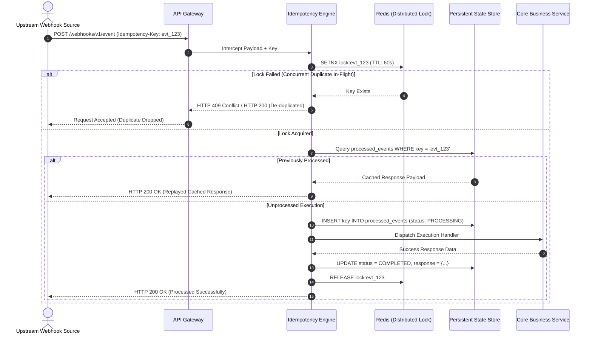

# Crucenne Webhook Idempotency Engine

Distributed, production-grade idempotency and de-duplication reference architecture engineered for high-throughput enterprise webhooks, payments, and asynchronous state synchronization pipelines.

---

## The Problem
Distributed webhook senders (Stripe, Shopify, ERP event streams) guarantee **at-least-once delivery**. In high-concurrency environments, network retries and transient timeouts often trigger duplicate concurrent executions, leading to race conditions, double charging, and corrupted database ledger balances.

---

## Architectural Workflow



---

## Core Enterprise Guardrails

- **Distributed Concurrency Lock**: Redis `SETNX` with a sliding TTL prevents parallel workers from processing identical payloads simultaneously.
- **Payload Signature Verification**: SHA-256 payload hashing ensures that malicious or erroneous key-reuse attempts with modified request bodies fail deterministically.
- **Safe Response Replay**: Fully processed events return the cached execution payload directly from the database without touching internal downstream services.
- **Fail-Safe Crash Recovery**: If a worker crashes mid-transaction, Redis lock TTL expiration paired with persistent state recovery routines unblocks subsequent retries safely.

---

## Project Structure

```text
├── docker-compose.yml           # Redis & State Store local topology
├── contracts/
│   └── sample_payload.json      # Standardized enterprise webhook schema
├── src/
│   ├── middleware/
│   │   └── idempotency.ts       # Core cryptographic hashing & lock gate
│   └── storage/                 # Persistence & distributed lock handlers
└── README.md
```

---

## Running the Mock Environment

```bash
docker compose up -d
```